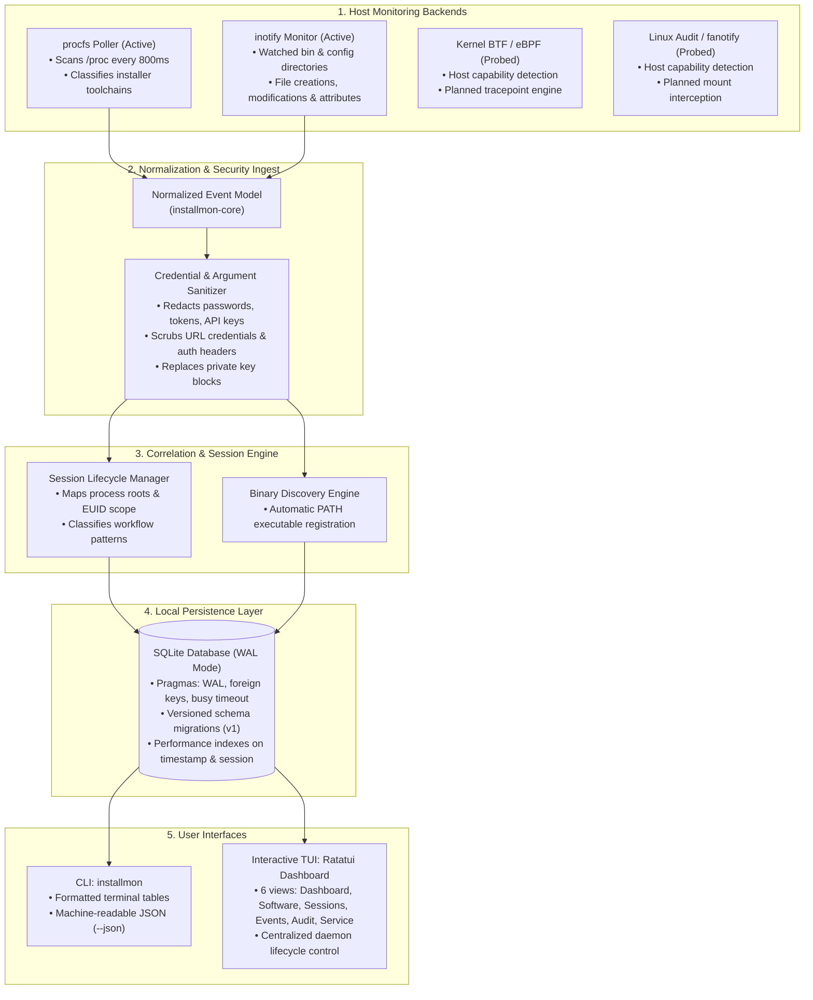

<div align="center">

# 📦 InstallMon

**Linux Software Installation Monitoring & Provenance Tracking**

[](https://github.com/ankur3-101106/installmon/actions/workflows/ci.yml)
[](https://github.com/ankur3-101106/installmon/releases)
[](LICENSE)
[](https://www.rust-lang.org/)
[](docs/compatibility/matrix.md)
[](docs/compatibility/matrix.md)

<p align="center">
  <a href="#-key-highlights">Highlights</a> •
  <a href="#-quick-start">Quick Start</a> •
  <a href="#-terminal-ui-preview">TUI Preview</a> •
  <a href="#-how-it-works">Architecture</a> •
  <a href="docs/">Documentation Hub</a> •
  <a href="docs/development/contributing.md">Contributing</a>
</p>

</div>

---

### What is InstallMon?

**InstallMon** observes how software enters, gets installed, and changes within a Linux host. It records installation workflows, reconstructs execution history, identifies installed software binaries, and maintains provenance records—**without wrapping package managers or modifying system execution flows**.

Modern Linux hosts accumulate software through many disconnected vectors—native package managers (`apt`, `pacman`, `dnf`), language ecosystem installers (`cargo`, `pip`, `npm`, `uv`, `go install`), source compilation (`make`, `cmake`), ad-hoc scripts (`curl ... | bash`), and unpacked archives (`tar -xzf`).

Most distributions only track software installed through their native package manager. Software installed via other vectors remains invisible to system audits, creating configuration drift, blind spots, and untracked binaries. **InstallMon closes this gap** by operating non-invasively as a background observer and maintaining a local, queryable provenance catalog in SQLite WAL mode.

---

## ⚡ The InstallMon Difference

| Traditional Linux System | With InstallMon Installed |
| :--- | :--- |
| ❌ Ad-hoc installs (`curl \| bash`) leave no audit trail | ✅ Every installer process & child execution is captured and correlated |
| ❌ Binaries in `~/.local/bin` and `~/.cargo/bin` are untracked | ✅ Inotify directory watches automatically register newly placed binaries |
| ❌ Plaintext credentials in scripts leak into shell history | ✅ Ingest-time scrubber redacts tokens, passwords, and private keys |
| ❌ Missing or deleted executables cause silent failures | ✅ `installmon audit` checks physical filesystem state against database records |
| ❌ Tool wrappers slow down execution pipelines | ✅ Completely out-of-band: zero wrappers, zero interceptors, zero slowdown |

---

## 🖥️ Terminal UI Preview

InstallMon includes an interactive terminal user interface built with [Ratatui](https://github.com/ratatui/ratatui):

```text
┌─ InstallMon v0.1.0 ────────────────────────────────────────────────────────────────────────┐
│  [1] Dashboard    [2] Software    [3] Sessions    [4] Events    [5] Audit    [6] Service   │
├────────────────────────────────────────────────────────────────────────────────────────────┤
│ Host: Linux 6.8 [x86_64]   • Scope: User (Unprivileged)  • Mode: SQLite WAL (Normal sync)  │
│ Backends: [procfs (800ms)] [inotify]                     • Daemon: Active (PID 4821)       │
│ Database: 1,420 Events     • 14 Sessions                 • 64 Tracked Binaries             │
├────────────────────────────────────────────────────────────────────────────────────────────┤
│ TRACKED SOFTWARE INVENTORY                                                                 │
│ NAME       SCOPE   DISCOVERED            PRIMARY BINARY PATH                               │
│ ripgrep    User    2026-11-19 14:12:05   /home/user/.cargo/bin/rg                          │
│ starship   User    2026-11-19 14:15:32   /home/user/.local/bin/starship                    │
│ neovim     System  2026-11-19 14:18:10   /usr/local/bin/nvim                               │
│ uv         User    2026-11-19 14:22:45   /home/user/.local/bin/uv                          │
├────────────────────────────────────────────────────────────────────────────────────────────┤
│ [1..6] Tabs | [j/k] Scroll | [s] Scan PATH | [r] Refresh | [?] Help Modal | [q] Exit       │
└────────────────────────────────────────────────────────────────────────────────────────────┘
```

---

## 🚀 Key Highlights

- **🔍 Filesystem & Process Ingestion**: Multi-directory `inotify` observation on executable paths (`/usr/local/bin`, `~/.local/bin`, `~/.cargo/bin`) paired with periodic `/proc` process polling.
- **🛡️ Ingest-Time Secret Sanitization**: Built-in credential scrubber that redacts passwords, tokens, API keys, HTTP Authorization headers, URL credentials, and private keys before records touch disk.
- **🔗 Session Correlation & Provenance**: Automatically links initiating commands, process ancestry (PID/PPID/UID/EUID), and filesystem mutations into structured installation sessions.
- **🖥️ Interactive Terminal UI (TUI)**: Rich Ratatui interface with 6 tabs (Dashboard, Software, Sessions, Events, Audit, Service) and direct background daemon management.
- **💻 12-Subcommand CLI with JSON Output**: Formatted terminal tables or machine-readable JSON (`--json`) across all inspection, querying, and export commands.
- **🗄️ Zero-Config Embedded SQLite (WAL Mode)**: Thread-safe local persistence with Write-Ahead Logging, automated schema migrations (`v1`), and integrity auditing.
- **📦 Universal Static Binaries**: Self-contained `musl` binaries for `x86_64` and `aarch64` with zero dynamic library dependencies.

---

## ⚙️ How It Works



---

## ⚡ Quick Start

### 1. Install via Unified Lifecycle Assistant (Recommended)

One command installs or updates InstallMon, verifies SHA-256 checksums, and optionally configures the continuous background daemon:

```bash
curl -fsSL https://raw.githubusercontent.com/ankur3-101106/installmon/main/install.sh | bash
```

> [!TIP]
> The installer requires **zero root or sudo permissions** for User Mode (`~/.local/bin`). For system-wide deployment, choose System Mode (`/usr/local/bin`).

### 2. Take It for a Spin

```bash
# Check host environment and database metrics
installmon status

# Discover existing executables across PATH
installmon scan

# Launch the interactive terminal dashboard
installmon
```

---

## 📚 Documentation Hub

Detailed technical guides, command specifications, and architectural documentation are maintained in the [`docs/`](docs/) directory:

| Guide | Description |
| :--- | :--- |
| [📦 **Installation & Lifecycle Guide**](docs/installation/guide.md) | Single-command installer, prebuilt archives, checksums, building from source, systemd setup, and uninstallation. |
| [💻 **CLI Command Reference**](docs/cli/reference.md) | Complete reference for all 12 subcommands, global options, arguments, syntax, and JSON output formats. |
| [🖥️ **Terminal User Interface (TUI) Guide**](docs/tui/guide.md) | Ratatui terminal dashboard walkthrough, 6 views, keyboard navigation, and centralized service control. |
| [🏗️ **Architecture Overview**](docs/architecture/overview.md) | Ingestion pipeline breakdown, event normalization, session correlation, and Cargo workspace structure. |
| [🗄️ **Database Schema Specification**](docs/database/schema.md) | Entity-relationship diagrams, SQLite WAL configuration, pragmas, schema migrations, and maintenance. |
| [🔒 **Security & Argument Sanitization**](docs/security/sanitization.md) | Least privilege design, credential scrubbing rules, regex filters, offline-first policy, and audit boundaries. |
| [🐧 **Platform Compatibility Matrix**](docs/compatibility/matrix.md) | Active vs probed capabilities (eBPF, fanotify, audit, procfs, inotify), Linux distros, and container environments. |
| [🛠️ **Troubleshooting & FAQ**](docs/troubleshooting/faq.md) | Diagnosing permissions, SQLite database locks, terminal truecolor issues, systemd lingering, and common questions. |
| [🚀 **Development & Contributing**](docs/development/contributing.md) | Rust toolchain requirements, formatting, Clippy lints, running test suites, release packaging, and CI workflows. |
| [🗺️ **Project Roadmap**](docs/roadmap.md) | Implemented capabilities vs planned future enhancements (kernel eBPF tracepoints, netlink audit streaming). |

---

## 💻 CLI Commands at a Glance

| Command | Summary | Reference |
| :--- | :--- | :--- |
| `installmon` / `installmon tui` | Launch the interactive visual dashboard | [Docs](docs/tui/guide.md) |
| `installmon status` | Display database metrics and backend health | [Docs](docs/cli/reference.md#installmon-status) |
| `installmon capabilities` | Probe kernel BTF, inotify, fanotify, audit, libc, and init system | [Docs](docs/cli/reference.md#installmon-capabilities) |
| `installmon list` | List all discovered software packages | [Docs](docs/cli/reference.md#installmon-list) |
| `installmon scan [DIRS...]` | Scan PATH and target directories for executables | [Docs](docs/cli/reference.md#installmon-scan) |
| `installmon inspect <NAME>` | View installation provenance, artifacts, and evidence | [Docs](docs/cli/reference.md#installmon-inspect) |
| `installmon history` | View chronological timeline of installation sessions | [Docs](docs/cli/reference.md#installmon-history) |
| `installmon sessions` | List tracked installation sessions in table format | [Docs](docs/cli/reference.md#installmon-sessions) |
| `installmon events` | Query observed lifecycle events with filters and pagination | [Docs](docs/cli/reference.md#installmon-events) |
| `installmon audit` | Verify SQLite database integrity and audit disk binaries | [Docs](docs/cli/reference.md#installmon-audit) |
| `installmon export` | Export tracking records to JSON or JSON-Lines (`jsonl`) | [Docs](docs/cli/reference.md#installmon-export) |
| `installmon daemon` | Run continuous monitoring daemon in foreground | [Docs](docs/cli/reference.md#installmon-daemon) |
| `installmon service <ACTION>` | Manage background service lifecycle (setup, start, stop, enable) | [Docs](docs/cli/reference.md#installmon-service) |

---

## 🛠️ Development & Verification

Ensure you have Rust **1.80.0+** installed:

```bash
# Verify formatting, lints, and test suites
cargo fmt --all -- --check
cargo clippy --workspace --all-targets -- -D warnings
cargo test --workspace

# Compile release binary
cargo build --workspace --release
```

See the [Development & Contributing Guide](docs/development/contributing.md) for complete workflows.

---

## 📄 License

InstallMon is free software licensed under the **GNU General Public License Version 3 (GPL-3.0-only)**. See the [LICENSE](LICENSE) file for complete details.
