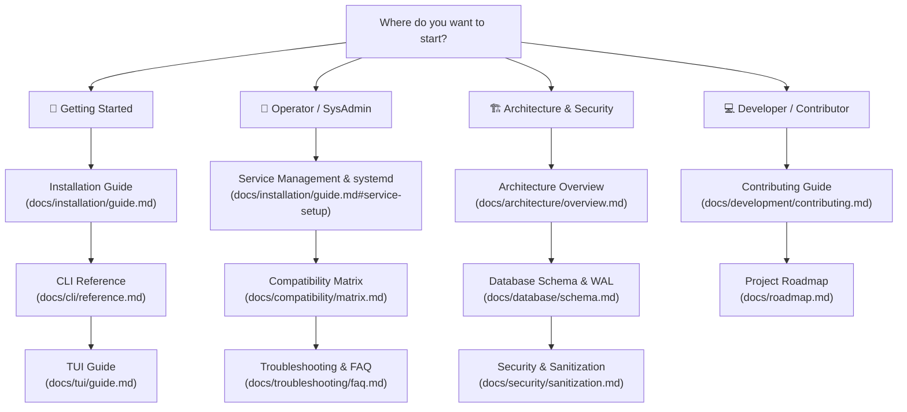

# InstallMon Documentation Hub

[](../LICENSE)
[]()
[](https://www.rust-lang.org/)

Welcome to the **InstallMon Documentation Hub**. This directory provides technical references, user guides, architecture specifications, and operational manuals for InstallMon.

---

## 🧭 Guided Reading Paths

Choose the path that best matches your immediate goal:



---

## 📚 Complete Documentation Index

| Section | Document | Description | Target Audience |
| :--- | :--- | :--- | :--- |
| **Getting Started** | [📦 Installation & Lifecycle](installation/guide.md) | Single-command installer, prebuilt archives, checksums, user vs systemd daemon setup, and uninstallation. | All Users |
| **Interfaces** | [💻 CLI Command Reference](cli/reference.md) | Syntax, options, examples, and JSON output formats for all 12 CLI subcommands. | Users, Automation Scripts |
| **Interfaces** | [🖥️ Terminal UI (TUI) Guide](tui/guide.md) | Ratatui terminal dashboard, 6 views, keyboard shortcuts, and centralized service management. | Interactive Users |
| **System Design** | [🏗️ Architecture Overview](architecture/overview.md) | Pipeline breakdown, event normalization, session correlation, and Cargo workspace crate roles. | Architects, Developers |
| **Storage** | [🗄️ Database & Schema](database/schema.md) | Embedded SQLite in WAL mode, ER diagrams, versioned migrations, retention, and maintenance. | Operators, Developers |
| **Security** | [🔒 Security & Sanitization](security/sanitization.md) | Least privilege design, credential scrubbing rules, regex filters, and audit boundaries. | Security Engineers |
| **Compatibility**| [🐧 Compatibility Matrix](compatibility/matrix.md) | Active vs probed capabilities (eBPF, fanotify, audit, procfs, inotify), distro and libc support. | SysAdmins, Integrators |
| **Operations** | [🛠️ Troubleshooting & FAQ](troubleshooting/faq.md) | Solutions for permission issues, locked databases, terminal glitches, and daemon lifecycle. | Operators, Users |
| **Development**| [🚀 Development & Contributing](development/contributing.md) | Toolchain requirements, cargo build/test/clippy workflows, smoke testing, and CI/CD pipelines. | Contributors |
| **Evolution** | [🗺️ Project Roadmap](roadmap.md) | Currently implemented features vs planned future capabilities (eBPF, netlink audit, fanotify). | Community |

---

## ⚡ Quick Common Tasks

<details>
<summary><b>How do I install InstallMon with one command?</b></summary>

Run the interactive lifecycle assistant:
```bash
curl -fsSL https://raw.githubusercontent.com/ankur3-101106/installmon/main/install.sh | bash
```
See the full [Installation Guide](installation/guide.md).
</details>

<details>
<summary><b>How do I launch the interactive terminal dashboard?</b></summary>

Simply run:
```bash
installmon
# or explicitly:
installmon tui
```
See the full [TUI Guide](tui/guide.md).
</details>

<details>
<summary><b>How do I export records to JSON or SIEM log pipelines?</b></summary>

Export events as JSON-Lines:
```bash
installmon export --entity events --format jsonl -o events.jsonl
```
See the full [CLI Command Reference](cli/reference.md#installmon-export).
</details>

<details>
<summary><b>How does InstallMon protect sensitive credentials?</b></summary>

All process arguments are scrubbed at ingestion time. Passwords, API tokens, Authorization headers, and private keys are redacted to `[REDACTED]` before records touch SQLite.
See the full [Security & Sanitization Guide](security/sanitization.md).
</details>

---

[← Back to Main README](../README.md)
