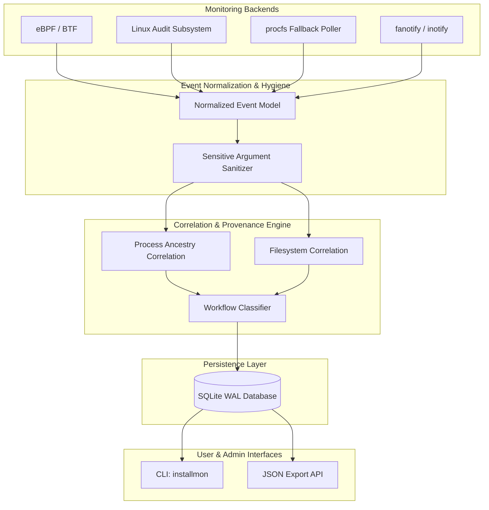

# Architecture Overview: InstallMon

## 1. System Vision

InstallMon is designed to solve software installation blind spots on Linux. Modern Linux hosts accumulate software through many disconnected vectors:
- Traditional package managers (apt, pacman, dnf)
- Language package ecosystems (cargo, pip, npm, uv, go install)
- Direct binary downloads (`curl ... | sh` or direct executable placement)
- Source code compilation (`make`, `cmake`, `ninja`)
- Unpacked archives (`tar -xzf`, `unzip`)
- AppImages and self-extracting bundles

InstallMon bridges this gap by observing the execution and mutation flow continuously and non-invasively.

## 2. Component Structure

### `installmon-core`
- **Normalized Event Model**: Unifies process exec, fork, exit, filesystem mutations, download events, and build lifecycles into a strongly-typed schema.
- **Sensitive Argument Sanitizer**: Regex and token-aware scrubber ensuring passwords, tokens, API keys, HTTP authorization headers, and private keys are never persisted or logged.
- **Provenance & Evidence**: Models confidence levels (`High`, `Medium`, `Low`), scopes (`User`, `System`, `Hybrid`), and evidence chains.

### `installmon-platform`
- **Capability Detection**: Probes host kernel, distribution, libc, CPU architecture, virtualization (WSL2, Docker, LXC, Podman), and available kernel facilities (`/sys/kernel/btf/vmlinux`, `/proc/sys/fs/inotify`, etc.).
- **Backend Negotiation**: Selects optimal process and filesystem monitoring backends dynamically with graceful degradation.
- **Path Resolution**: Provides XDG and system-wide paths with fallback for read-only or container environments.

### `installmon-database`
- **SQLite Engine**: Embedded, zero-configuration local persistence in WAL mode with transactional batch commits.
- **Schema Migrations**: Versioned database schemas for events, sessions, processes, software, installations, artifacts, sources, evidence, and capabilities.
- **Integrity Verification**: Built-in verification via `PRAGMA integrity_check`.

### `installmon-cli`
- **Binary**: `installmon`.
- **Command Set**: `status`, `capabilities`, `list`, `scan`, `inspect`, `history`, `sessions`, `events`, `audit`, and `export`.
- **Machine Readability**: Standardized `--json` output across commands.
