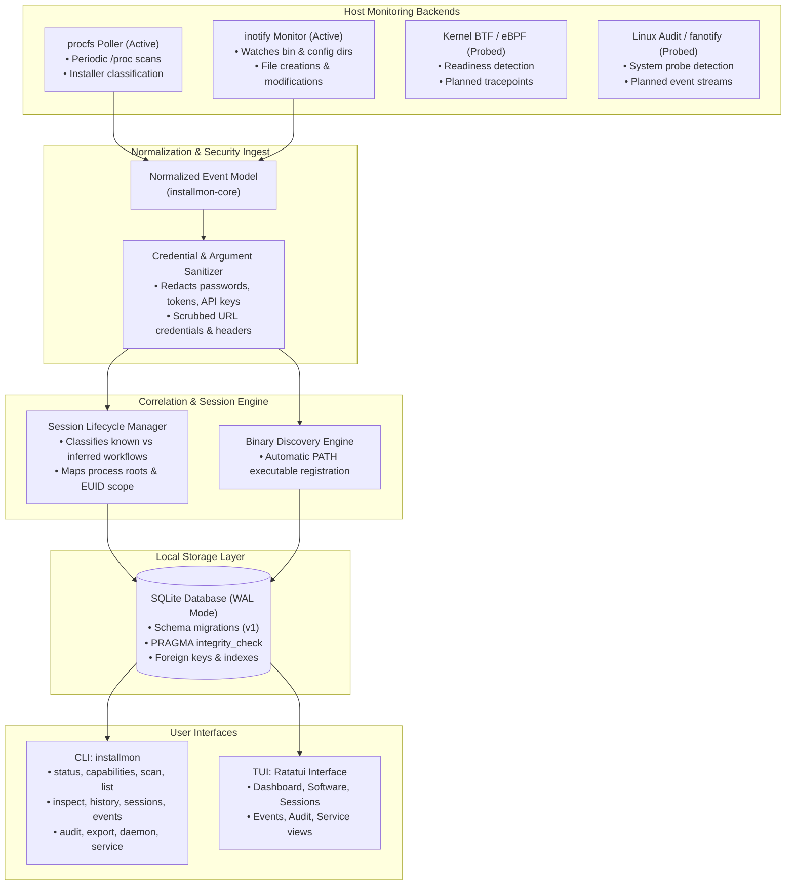

# Architecture Overview: InstallMon

## 1. System Vision

InstallMon observes how software enters, gets installed, and changes within a Linux environment. Modern Linux hosts accumulate software through many disconnected vectors:
- Traditional package managers (`apt`, `pacman`, `dnf`, `apk`)
- Language package ecosystems (`cargo`, `pip`, `npm`, `uv`, `go install`, `gem`)
- Direct binary downloads (`curl ... | sh`, `wget`, direct executable placement)
- Source code compilation (`make`, `cmake`, `ninja`, `meson`)
- Unpacked archives (`tar -xzf`, `unzip`, `7z`)
- System & user binary directories (`/usr/local/bin`, `~/.local/bin`, `/opt`)

InstallMon observes this execution and filesystem mutation flow continuously and non-invasively, providing provenance tracking without requiring invasive kernel patches or wrapping package managers.

## 2. Component Structure

### `installmon-core`
- **Normalized Event Model**: Strongly-typed structures for process execution, lifecycle mutations, downloads, and installation states.
- **Sensitive Argument Sanitizer**: Regex and token-aware scrubber ensuring passwords, tokens, API keys, HTTP authorization headers, and private keys are never persisted or logged.
- **Provenance & Evidence**: Models confidence levels (`High`, `Medium`, `Low`), scopes (`User`, `System`, `Hybrid`), and evidence chains.

### `installmon-platform`
- **Capability Detection**: Probes host kernel, distribution, libc, CPU architecture, virtualization (WSL2, Docker, LXC, Podman), and available kernel facilities (`/sys/kernel/btf/vmlinux`, `/proc/sys/fs/inotify`, `/proc/net/netlink`).
- **Path Resolution**: Provides standard XDG user paths and `/var/lib/installmon` system paths with automatic `/tmp` fallback for restricted container environments.
- **Service Management**: Controls background daemon lifecycle across systemd user units, systemd system units, and standalone detached background processes.

### `installmon-database`
- **SQLite Engine**: Embedded, zero-configuration local persistence in WAL mode with transactional batch commits.
- **Schema Migrations**: Versioned database schemas for events, sessions, processes, software, installations, artifacts, sources, evidence, and capabilities.
- **Integrity Verification**: Built-in verification via `PRAGMA integrity_check`.

### `installmon-tui`
- **Terminal User Interface**: Built on Ratatui 0.29 and Crossterm 0.28.
- **Navigation & Inspection**: 6 interactive views: Dashboard, Software, Sessions, Events, Audit, and Service.
- **Centralized Control**: Setup, toggle, restart, and inspect the background daemon directly from the terminal.

### `installmon-cli`
- **Binary**: `installmon`.
- **Command Set**: `tui`, `status`, `capabilities`, `list`, `scan`, `inspect`, `history`, `sessions`, `events`, `audit`, `export`, `daemon`, and `service`.
- **Machine Readability**: Standardized `--json` output across commands.
