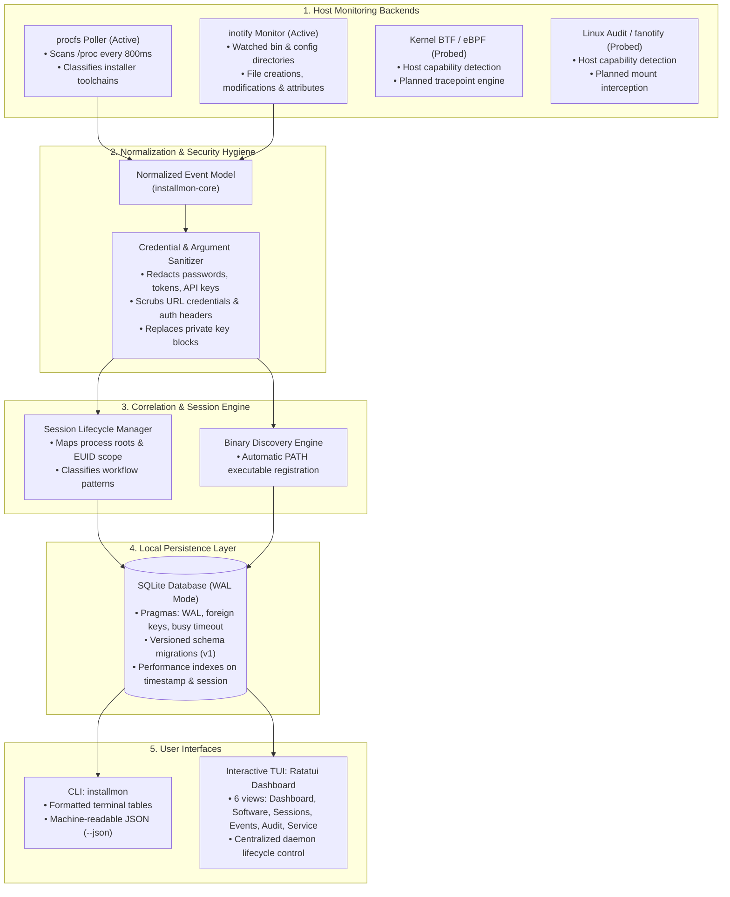

# Architecture Overview: InstallMon

[InstallMon](../../README.md) > [Documentation Hub](../README.md) > Architecture Overview

InstallMon observes how software enters, gets installed, and changes within a Linux host. It operates non-invasively through an ingest, sanitize, correlate, and persist pipeline without wrapping package managers or modifying system execution flows.

---

## 1. System Pipeline



---

## 2. Event Flow & Normalization

1. **Ingestion**:
   - The daemon monitors specified binary directories (`/usr/local/bin`, `~/.local/bin`, `~/.cargo/bin`, etc.) via non-blocking Linux `inotify`.
   - The daemon polls `/proc` every 800ms to detect newly spawned processes.
2. **Classification**:
   - Commands are inspected against known installer signatures (`apt`, `cargo`, `pip`, `make`, `curl`, `git clone`, `tar`).
   - If an installer is detected, an active `SessionRecord` is initialized.
3. **Sanitization**:
   - Command arguments pass through `sanitize_arguments` before being recorded into event structures. See [Security & Sanitization](../security/sanitization.md).
4. **Persistence**:
   - Events and sessions are committed into the local SQLite database inside WAL-mode transactions. See [Database Schema Specification](../database/schema.md).
5. **Presentation**:
   - The CLI and TUI read directly from the shared SQLite database and daemon heartbeat file. See [CLI Reference](../cli/reference.md) and [TUI Guide](../tui/guide.md).

---

## 3. Cargo Workspace Crate Architecture

The repository is organized as a modular Cargo workspace across 5 crates:

```text
installmon/
├── crates/
│   ├── core/                   # Normalized event schema, provenance models, sanitizer
│   ├── platform/               # Capability detector, path resolution, service manager
│   ├── database/               # SQLite connection, schema migrations, models
│   ├── tui/                    # Ratatui terminal user interface and view renderers
│   └── cli/                    # CLI binary (installmon), subcommands, background daemon
```

| Crate | Responsibility | Primary Dependencies |
| :--- | :--- | :--- |
| **`installmon-core`** | Defines normalized event models (`Event`, `EventType`), provenance structures (`InstallationProvenance`, `WorkflowClassification`), and the credential argument sanitizer (`sanitize_arguments`). | `serde`, `serde_json`, `chrono`, `uuid`, `thiserror`, `regex` |
| **`installmon-platform`** | Probes host OS, libc, init system, virtualization (WSL2, Docker, LXC), and kernel monitoring interfaces. Manages systemd units and daemon heartbeats. | `installmon-core`, `serde`, `chrono`, `uuid`, `nix`, `libc`, `anyhow` |
| **`installmon-database`** | Thread-safe SQLite repository operating in WAL mode. Manages versioned migrations, transactional batch writes, and entity querying. | `installmon-core`, `installmon-platform`, `rusqlite` (bundled), `tracing` |
| **`installmon-tui`** | Terminal User Interface with 6 tabs, modal overlays, keyboard navigation, and centralized background service control. | `installmon-database`, `ratatui`, `crossterm`, `chrono`, `anyhow` |
| **`installmon-cli`** | Binary entrypoint (`installmon`). Implements CLI commands, JSON output formatting, and the continuous background daemon monitoring loop. | All workspace crates, `clap` (derive), `tracing`, `tracing-subscriber` |

---

## Related Documentation & Next Steps

- 🗄️ [Database Schema Specification](../database/schema.md) — Table schemas, relations, and WAL performance tuning.
- 🔒 [Security & Sanitization](../security/sanitization.md) — Ingest-time secret redaction rules.
- 🐧 [Platform Compatibility Matrix](../compatibility/matrix.md) — Active vs probed kernel capabilities.
- 🗺️ [Project Roadmap](../roadmap.md) — Future architecture plans (eBPF, netlink audit, fanotify).

---

[← Back to Documentation Hub](../README.md) | [← Back to Main README](../../README.md)
