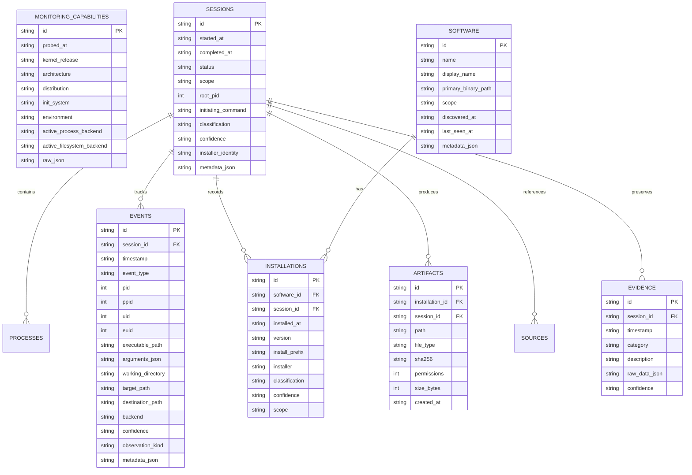

# Database Schema Specification

InstallMon uses SQLite with Write-Ahead Logging (`PRAGMA journal_mode = WAL`) and foreign key enforcement (`PRAGMA foreign_keys = ON`).

## Entities

## Performance & Durability Indexes
- `idx_events_timestamp` on `events(timestamp)`
- `idx_events_session` on `events(session_id)`
- `idx_events_type` on `events(event_type)`
- `idx_events_target` on `events(target_path)`
- `idx_processes_pid` on `processes(pid)`
- `idx_processes_session` on `processes(session_id)`
- `idx_artifacts_path` on `artifacts(path)`
- `idx_software_name` on `software(name)`
- `idx_sessions_status` on `sessions(status)`
