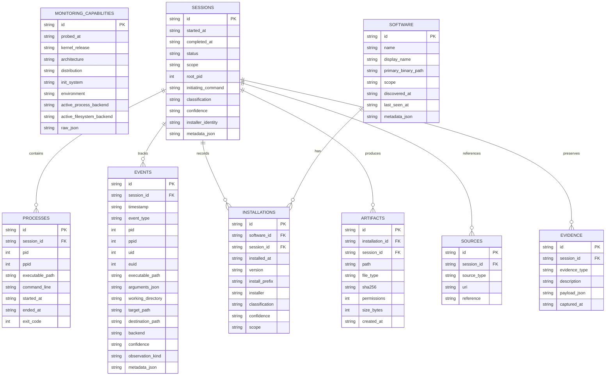

# Database Schema Specification: InstallMon

[InstallMon](../../README.md) > [Documentation Hub](../README.md) > Database Schema

InstallMon utilizes an embedded SQLite engine for zero-configuration, thread-safe local data storage. It operates in Write-Ahead Logging (`WAL`) mode to support concurrent reading and writing without lock contention.

---

## 1. Entity-Relationship Diagram



---

## 2. Storage Locations & Paths

InstallMon dynamically resolves its storage paths based on execution scope:

| Scope | Default Database Path | Environment Variable Override | Fallback Path |
| :--- | :--- | :--- | :--- |
| **User Mode** | `~/.local/share/installmon/installmon.db` | `XDG_DATA_HOME/installmon/installmon.db` | `/tmp/installmon/installmon.db` |
| **System Mode** | `/var/lib/installmon/installmon.db` | Explicit `--database <PATH>` | `/tmp/installmon/installmon.db` |

---

## 3. High-Performance SQLite Pragmas

Upon opening every database connection, InstallMon applies the following pragmas:

```sql
PRAGMA journal_mode = WAL;
PRAGMA synchronous = NORMAL;
PRAGMA foreign_keys = ON;
PRAGMA busy_timeout = 5000;
PRAGMA temp_store = MEMORY;
```

- **Write-Ahead Logging (WAL)**: Ensures read operations never block write operations and write operations never block reads.
- **Foreign Keys**: Enforces relational consistency across sessions, installations, artifacts, and evidence.
- **Busy Timeout**: Sets a 5000ms retry timeout to eliminate transient locking errors during heavy write activity.

---

## 4. Automated Schema Migrations

The database manages schema evolution automatically via the `schema_migrations` table:

```sql
CREATE TABLE schema_migrations (
    version INTEGER PRIMARY KEY,
    applied_at TEXT NOT NULL,
    description TEXT NOT NULL
);
```

- **Migration v1**: Initializes core tables: `monitoring_capabilities`, `sessions`, `processes`, `events`, `software`, `installations`, `artifacts`, `sources`, and `evidence`.
- **Indexes**: Includes performance indexes on `events(timestamp)`, `events(session_id)`, `events(event_type)`, `events(target_path)`, `processes(pid)`, `artifacts(path)`, `software(name)`, and `sessions(status)`.

---

## 5. Maintenance & Integrity Checks

- **Run Integrity Audit**:
  ```bash
  installmon audit
  ```
  Runs `PRAGMA integrity_check` and verifies tracked binary files against the filesystem.
- **Backup & SIEM Export**:
  ```bash
  # Export all records as pretty JSON
  installmon export --entity all --format json -o backup.json

  # Export event stream as JSON-Lines for external log ingestion
  installmon export --entity events --format jsonl
  ```

---

## Related Documentation & Next Steps

- 🏗️ [Architecture Overview](../architecture/overview.md) — System design and event persistence pipeline.
- 🔒 [Security & Sanitization](../security/sanitization.md) — How arguments are scrubbed before reaching SQLite.
- 💻 [CLI Command Reference](../cli/reference.md) — Documentation for `installmon audit` and `installmon export`.

---

[← Back to Documentation Hub](../README.md) | [← Back to Main README](../../README.md)
